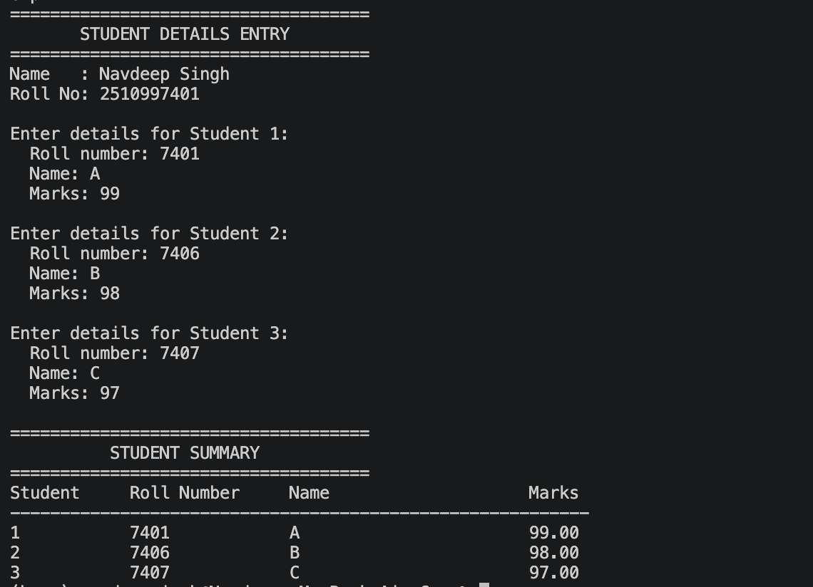

# Explanation of `exp2.c++`

This program uses a `Student` class to collect and display the roll number,
name, and marks for three students.

## Program output

The screenshot below shows an example run of the program:

In this example, the program collects details for three students and displays
them in a summary table. The names and marks shown are sample input.

## How the code works

### Header files and namespace

- `<iostream>` provides `cin` and `cout` for reading input and printing output.
- `<iomanip>` provides output formatting tools such as `setw`, `fixed`, and
  `setprecision`.
- `<string>` provides the `string` type and is used to create the dashed line
  in the summary.
- `using namespace std;` lets the program use standard library names without
  writing `std::` before each one.

### The `Student` class

The `Student` class groups the information and operations for one student:

- `rollNo` stores the roll number as an `int`.
- `name` stores the student's name as a `string`.
- `marks` stores the student's marks as a `float`.

These data members are private by default because they are declared before
`public:`.

### Reading student details

The `getDetails()` member function asks for a roll number, name, and marks.
`cin` reads the numeric roll number and marks. `getline(cin >> ws, name)` reads
the full name, including spaces; `ws` first consumes whitespace left over from
the previous input.

### Displaying student details

The `displayDetails()` member function prints one row of the summary table.
Its parameter identifies the student's position (1, 2, or 3). `left` and
`setw` align the table columns. `fixed` and `setprecision(2)` show marks with
two digits after the decimal point.

### The `main()` function

`main()` prints the heading, creates three `Student` objects (`s1`, `s2`, and
`s3`), and calls `getDetails()` for each object. It then prints the table
headings, a line of dashes, and each student's details. `return 0;` indicates
that the program finished successfully.

## Important note about roll numbers

In the current source code, `rollNo` is an `int`, so it can only store values
within the range supported by `int`. A long roll number such as `2510997401`
may exceed that range and produce incorrect input. Use a wider integer type or
store roll numbers as `string` if the program needs to support long values or
preserve leading zeros.
