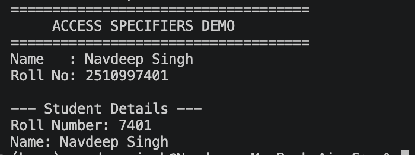
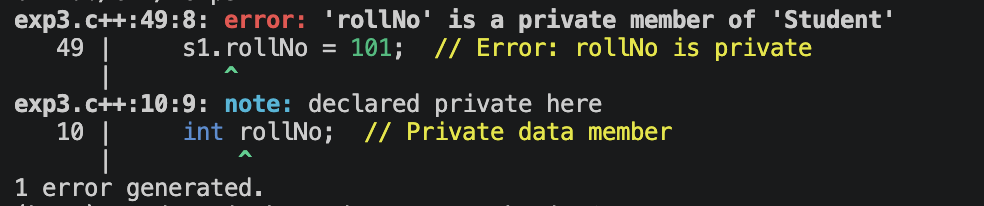

# Explanation of `exp3.c++`

This program demonstrates C++ access specifiers by storing and displaying a
student's roll number and name.

## Example screenshots

### Accessing the private roll number through a public function

The program sets the private roll number by calling `setRollNo()` and displays
it with `display()`, both public member functions.

### Error when accessing a private member directly

This compiler output shows the error produced when code outside the class
tries to assign directly to `s1.rollNo`. Since `rollNo` is private, it can
only be accessed by the class's own member functions.

## Header files and namespace

- `<iostream>` provides `cout` and `endl` for displaying text.
- `<string>` provides the `string` type used to store the student's name.
- `using namespace std;` lets the program use these standard library names
  without writing `std::` before each one.

## The `Student` class

The `Student` class groups the data and functions associated with a student.

- `private:` makes members declared beneath it accessible only from within
  the class. Here, `rollNo` is private.
- `public:` makes members declared beneath it accessible from outside the
  class. Here, `name`, `setRollNo()`, and `display()` are public.

Keeping `rollNo` private prevents code outside the class from changing it
directly.

## The `setRollNo()` function

`setRollNo(int r)` is a public member function. It receives an integer
parameter named `r` and assigns it to the private `rollNo` member. This lets
the program set the roll number through a controlled public interface.

## The `display()` function

`display()` prints the object's roll number and name. It can access the
private `rollNo` because it is a member function of the `Student` class.

## The `main()` function

`main()` is where the program starts:

1. It prints the access-specifier demonstration heading and identification
   text.
2. `Student s1;` creates a `Student` object named `s1`.
3. `s1.name = "Mr. A";` assigns the name directly because `name` is public.
4. `s1.setRollNo(7401);` sets the private roll number by calling the public
   setter function.
5. `s1.display();` prints the student's details.
6. `return 0;` indicates that the program completed successfully.

The commented-out statement `s1.rollNo = 101;` would cause a compilation
error because `rollNo` is private and cannot be accessed directly from
`main()`.

## Note about the displayed roll numbers

The heading prints `2510997401` as fixed text. The `Student` object is
separately assigned roll number `7401`. These are not the same value. Also,
the class stores its roll number as an `int`; a value such as `2510997401`
may exceed the range of `int`. Use a wider integer type or `string` if the
student's actual roll number needs to be stored.

## Conclusion

The example shows that public members can be accessed directly, while private
members must be accessed through public member functions. This helps a class
control how its data is changed and used.
